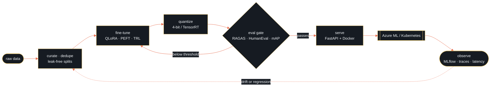

 

 

I build generative AI that keeps working after the demo, and I teach AI from first principles to Indian students.

 

> ### 🟢 Open to AI / ML Engineer roles
>
> **Generative AI · LLM Engineering · MLOps · Machine Learning** &nbsp;|&nbsp; full-time, Mumbai or remote
>
> If you're shipping an AI product that has to keep working *after* the demo, I'd like to hear about it.
> [**Start a conversation →**](https://www.linkedin.com/in/nikhilsatyawanpatil/)

 

**01**
## Who I am

I'm an AI/ML Engineer in Mumbai who builds **generative AI systems that hold up in production**: retrieval and agent pipelines that are evaluated rather than eyeballed, fine-tuned open models that fit real hardware budgets, and the MLOps scaffolding that keeps both reproducible.

My bias is toward the unglamorous half of the work: evaluation harnesses, tracing, caching, guardrails, and deploy pipelines. A model that scores well once is a demo. A model you can re-train, re-measure, and roll back is a product.

Outside the terminal I host **AI But Simple**, a 28 episode Hinglish podcast that explains AI from first principles to Indian CS students.

<table>
<tr><td width="140"><b>GENERATIVE&nbsp;AI</b></td><td>Multi-agent RAG with LangGraph · semantic search &amp; reranking · RAGAS evaluation · guardrails · streaming</td></tr>
<tr><td><b>FINE&#8209;TUNING</b></td><td>QLoRA · PEFT · TRL on Gemma 4 and Llama 3.2 · leak-free dataset splits · HumanEval-style benchmarking</td></tr>
<tr><td><b>MLOPS</b></td><td>Azure ML · MLflow tracking &amp; registry · Docker · Kubernetes · FastAPI · reproducible training pipelines</td></tr>
<tr><td><b>VISION</b></td><td>Production computer vision: YOLO + TensorRT deployment, 500K-image dataset curation</td></tr>
</table>

 

**02**
## By the numbers

 

**03**
## Selected work

<table>
<tr>
<td width="50%" valign="top">

#### 🧠 Agentic AI Research Assistant
`Generative AI` · `RAG` · `Evaluation`

A production multi-agent RAG system: four specialized agents chained **research → retrieval → fact-check → synthesis**, with the whole path instrumented.

10,000+ embeddings · semantic search with reranking · RAGAS scoring · Redis caching · WebSocket streaming · guardrails · MLflow tracking

`LangGraph` `RAGAS` `FastAPI` `Redis` `ChromaDB` `Docker`

[**Open repository →**](https://github.com/NikhilPatilAI/agentic-ai-research-assistant)

</td>
<td width="50%" valign="top">

#### ✍️ Gemma 4 · Instruction Tuning
`Fine-tuning` · `QLoRA` · `Data curation`

Fine-tuned **Gemma 4 E2B IT** with QLoRA + PEFT to turn a bare topic into a tight, hook-first short-form script.

5,000 samples · **leak-free grouped splits** · automated cleaning · conversational JSONL generation · reproducible eval

`Gemma 4` `QLoRA` `PEFT` `TRL` `Transformers`

[**Open repository →**](https://github.com/NikhilPatilAI/gemma4-e2b-tech-shorts-finetuning)

</td>
</tr>
<tr>
<td width="50%" valign="top">

#### 💻 Llama 3.2 · Code Generation
`Fine-tuning` · `Benchmarking`

Fine-tuned **Meta Llama 3.2 1B** with 4-bit QLoRA on a single **Tesla T4**, then held it to HumanEval `pass@1` and `pass@10` instead of cherry-picked samples.

`Llama 3.2` `PyTorch` `TRL` `HumanEval` `bitsandbytes`

[**Open repository →**](https://github.com/NikhilPatilAI/Llama-3.2-1B)

</td>
<td width="50%" valign="top">

#### 🛒 Retail Vision Pipeline
`MLOps` · `Computer vision` · `Deployment`

End-to-end CV deployment: 500K-image curation → YOLO training → TensorRT compilation → containerized inference on constrained hardware, cutting checkout time ~30%.

`YOLO` `TensorRT` `ONNX` `OpenCV` `Docker`

🔒 Code is private.

</td>
</tr>
</table>

Also shipped: <a href="https://github.com/NikhilPatilAI/tr-alert-gpt54-nano"><b>tr-alert</b></a>, a financial results alert worker (NSE/BSE scrapers → validation → GPT 5.4 nano → Telegram) &nbsp;·&nbsp; <a href="https://github.com/NikhilPatilAI?tab=repositories"><b>Browse all repositories →</b></a>

 

**04**
## How a model gets to production

 

**05**
## Teaching AI in public

Plenty of engineers can build with AI. Far fewer can explain it. **AI But Simple** takes one idea per episode and rebuilds it from first principles, in Hinglish, for Indian CS students who are tired of jargon and hype. The same approach now continues as short explainers on Instagram Reels and YouTube Shorts.

Teaching is also how I test my own understanding. If I can't explain it simply, I don't understand it well enough yet.

▶ [YouTube](https://www.youtube.com/channel/UCpakmXio90uAd4RBZqimG8Q) &nbsp;·&nbsp; 📸 [Instagram](https://www.instagram.com/nikhilpatil.ai/)

 

**06**
## Toolkit

| | |
|:--|:--|
| **Generative AI** | `LangGraph` `LangChain` `Transformers` `PEFT` `TRL` `bitsandbytes` `vLLM` |
| **Retrieval** | `ChromaDB` `FAISS` `RAGAS` `Redis` `sentence-transformers` |
| **ML & Vision** | `Python` `PyTorch` `TensorFlow` `Keras` `scikit-learn` `OpenCV` `ONNX` `TensorRT` |
| **MLOps & Cloud** | `Azure ML` `MLflow` `Docker` `Kubernetes` `FastAPI` `GitHub Actions` `Git` |
| **Data** | `NumPy` `Pandas` `PostgreSQL` `MySQL` |

 

**07**
## What I'm working on now

- 🧪 **Evaluation-first agents:** treating RAGAS scores, traces, and regression suites as release gates rather than dashboards.
- ⚖️ **Small-model economics:** how far QLoRA on compact open models gets you before a frontier API is worth the bill.
- 🔁 **Reproducible pipelines:** one command from raw data to a registered, versioned, rollback-able model.
- ⚡ **Serving efficiency:** quantization, batching, and caching, so latency and cost survive real traffic.

 

**08**
## Activity

 

 

 

[LinkedIn](https://www.linkedin.com/in/nikhilsatyawanpatil/) &nbsp;·&nbsp; [Email](mailto:nikhilsatyawanpatil@gmail.com) &nbsp;·&nbsp; [YouTube](https://www.youtube.com/channel/UCpakmXio90uAd4RBZqimG8Q) &nbsp;·&nbsp; [Instagram](https://www.instagram.com/nikhilpatil.ai/)

 

